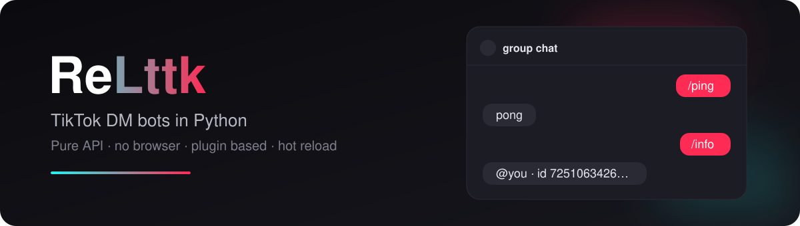
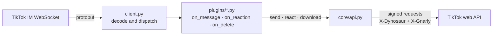

<div align="center">



**Build TikTok DM bots in Python. No browser, no Selenium, just TikTok's own API.**

[](https://www.python.org/)
[](LICENSE)
[](https://github.com/Linkmail16/ReLttk-TikTok-Client-Bot/stargazers)
[](https://github.com/Linkmail16/ReLttk-TikTok-Client-Bot/commits)

[Quick start](#quick-start) · [Your first plugin](#your-first-plugin) · [How it works](#how-it-works) · [API reference](#api-reference) · [Changelog](CHANGELOG.md)

</div>

---

ReLttk connects to TikTok's internal messaging WebSocket, decodes every incoming DM and hands it to your plugins. A plugin is a plain Python file with an `async` function. Drop it in `plugins/` and it is live, no restart needed.

```python
# plugins/hello.py
async def on_message(bot, msg):
    if msg["text"].strip() == "/hello":
        await bot.send_message(text="hello!", msg=msg)
```

## Features

| | |
|---|---|
| **Pure API** | Talks to TikTok's internal endpoints directly. No Selenium, Playwright or Puppeteer. |
| **Local request signing** | `X-Dynosaur` and `X-Gnarly` are computed in pure Python. No external signing service. |
| **QR login** | Scan with the TikTok app and you're in. Handles 2FA / identity checks (email or phone code). Re-asks for the QR when the session expires. |
| **Real-time DMs** | Private chats and groups over WebSocket: messages, reactions and deletions as they happen. |
| **Every message type** | Text, videos, photos, music, stickers, voice notes, stories, live streams, profiles and more. |
| **Plugins with hot reload** | Edit a plugin and it reloads instantly. Hooks for messages, reactions, deletions and startup. |
| **History and cache** | Paginated conversation history plus a local SQLite cache of recent messages. |
| **Downloads** | Save stickers, videos and voice notes from any message. |

## Quick start

**1. Install**

```bash
git clone https://github.com/Linkmail16/ReLttk-TikTok-Client-Bot.git
cd ReLttk-TikTok-Client-Bot
pip install -r requirements.txt
```

**2. Run**

```bash
python main.py
```

**3. Log in**

A QR code shows up in the terminal. Scan it with the TikTok app. The session is saved to `session/<username>.json`, so next time it starts straight away.

Send `/ping` to the account from another one and it answers `pong`.

<details>
<summary><b>Other ways to log in</b></summary>

<br>

Import cookies from a JSON file (a browser-extension export or a plain `{"name": "value"}` object):

```bash
python main.py cookies cookies.json
```

Or read them straight from your browser profile:

```bash
python main.py browser chrome
python main.py browser firefox
```

</details>

<details>
<summary><b>Console commands</b></summary>

<br>

| Command | What it does |
|---|---|
| `retry` | Reconnect |
| `stop` | Stop the bot and keep the session |
| `close` | Log out of TikTok, delete the session file and stop |

</details>

## Your first plugin

Create any `.py` file in `plugins/`. ReLttk picks it up automatically and calls the hooks it defines:

```python
# plugins/echo.py
async def on_message(bot, msg):
    text = msg["text"].strip()
    if text.startswith("/echo "):
        await bot.send_message(text=text[6:], msg=msg)
        await bot.send_reaction(emoji="👍", msg=msg)
```

| Hook | Called when |
|---|---|
| `on_start(bot)` | The bot has connected |
| `on_message(bot, msg)` | A new message arrives |
| `on_reaction(bot, rxn)` | A reaction is added or removed |
| `on_delete(bot, deleted)` | A message is deleted |

### Built-in commands

| Command | Description |
|---|---|
| `/ping` | Replies `pong` and deletes it after 3 s |
| `/info` | Shows the sender's username and user ID |
| `/react [emoji]` | Reacts to the message |
| `/menu` | Lists the available commands |
| `/dl` | Downloads the quoted sticker to `stickers/` |

## How it works



`client.py` keeps the WebSocket alive, decodes the protobuf frames into plain dicts and stores them in the local cache. `core/api.py` builds the HTTP calls (send, react, history, downloads) and `core/signer_client.py` signs them with the pure-Python signers in `signers/`.

## API reference

<details>
<summary><b>Bot methods</b></summary>

<br>

```python
# messages
await bot.send_message(text="hello!", msg=msg)
await bot.delete_message(msg=msg)
await bot.send_video(msg["conv_id"], "7123456789")   # share a TikTok video

# reactions
await bot.send_reaction(emoji="🔥", msg=msg)
await bot.remove_reaction(emoji="🔥", msg=msg)

# users and content
user = await bot.get_user(msg["sender_id"])           # user["unique_id"], user["nick_name"]
detail = await bot.get_item("7123456789")             # video detail
track = await bot.get_music("7123456789")             # music detail

# conversations
convs = await bot.get_conversations()
groups = await bot.get_groups()
privates = await bot.get_private_chats()
msgs = await bot.fetch_history(msg["conv_id"], count=20)

# local cache
cached = bot.get_message(msg["msg_id"])
recent = bot.get_messages(msg["conv_id"], limit=50)

# downloads: stickers, videos and voice notes
result = await bot.download(msg)
if result:
    data, filename = result

# debugging the protobuf
raw = await bot.fetch_history_raw(msg["conv_id"], count=20)
parsed = bot._proto_to_dict(raw)
```

</details>

<details>
<summary><b><code>msg</code> fields</b></summary>

<br>

| Field | Description |
|---|---|
| `text` | Message text |
| `sender_id` | Sender's user ID |
| `conv_id` | Conversation ID |
| `msg_id` | Message ID |
| `msg_type` | Internal type (used for reactions and deletes) |
| `awe_type` | Content type, see the table below |
| `is_group` | `True` in group chats |
| `video_id` | Video ID (`awe_type` 800 / 810) |
| `sticker_url` | Sticker URL (`awe_type` 1805) |
| `voice_id` | Voice note ID (`awe_type` 1813) |
| `quoted_text` | Text of the quoted message |
| `quoted_awe_type` | Content type of the quoted message |
| `proto` | Raw protobuf fields as a dict |

</details>

<details>
<summary><b>Message types (<code>awe_type</code>)</b></summary>

<br>

| Value | Type |
|---|---|
| `1` | Text |
| `22` | Music |
| `25` | User profile |
| `40` | Video comment |
| `800` / `810` | Video / photo |
| `1021` | Live stream |
| `1025` | Story |
| `1805` | Sticker |
| `1813` | Voice note |
| `1814` | Greeting card |
| `50001` | Group event |

</details>

<details>
<summary><b>Project structure</b></summary>

<br>

```
ReLttk/
├── main.py               entry point and console commands
├── client.py             WebSocket client, dispatch, cache, history
├── qrlogin.py            QR login with 2FA
├── browsercookies.py     cookie import from local browsers
├── config.py
├── core/
│   ├── api.py            HTTP endpoints (send, react, inbox, history…)
│   ├── proto.py          protobuf encoding and decoding
│   └── signer_client.py  request signing
├── signers/              X-Dynosaur, X-Gnarly, X-Bogus in pure Python
├── plugins/              ping, info, react, menu, videodl, stickerdl
└── session/              saved sessions (one JSON per account)
```

</details>

## Multiple accounts

Each account gets its own file in `session/`. The bot loads the first one it finds, so to switch accounts move or rename the files.

> [!CAUTION]
> `session/` holds your login cookies. Never commit it or share it.

## Disclaimer

> [!WARNING]
> ReLttk is an unofficial, reverse-engineered client. It is not affiliated with, endorsed by or connected to TikTok or ByteDance. Automating an account may go against TikTok's Terms of Service and can get it restricted. Use it at your own risk and on accounts you own.

## Contributing

This started as a personal project and is still early, so expect rough edges. Bug reports, fixes and new plugins are very welcome: open an issue or a pull request.

If ReLttk is useful to you, a star helps other people find it.

## License

[MIT](LICENSE)
